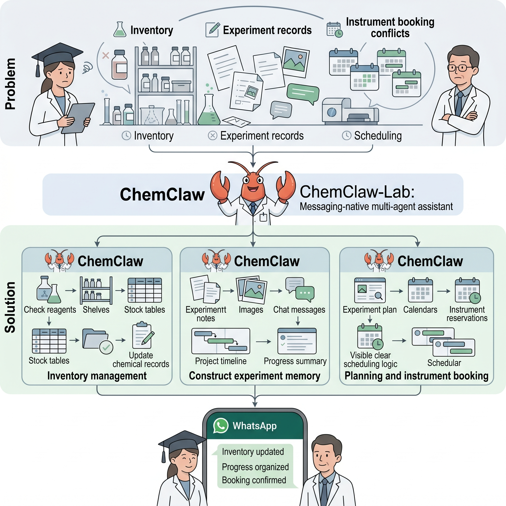

# ChemClaw-Lab

[](#project-status)
[](CHANGELOG.md)
[](LICENSE)
[](#repository-map)

ChemClaw-Lab is a messaging-native, event-centric, multi-agent framework for chemistry laboratory operations.

The local workbench now supports an LLM-directed Pi runtime: a coordinator chooses tools and delegates to configured specialists, observes their receipts, and returns results or requests for human input. Roles use Markdown prompts and manifests. Core retains project authorization, evidence validation, versioning, and transactional execution. See the [2026-10-20 runtime setup and implementation notes](docs/repair/AGENT_RUNTIME_2026-10-20_cn.md).

It is designed for small academic chemistry labs where daily work is fragmented across chat apps, spreadsheets, screenshots, and informal notes. The goal is to turn those fragmented inputs into structured, traceable, and actionable lab memory for:

- inventory and consumable management
- experiment memory construction
- planning and internal instrument booking

The long-term aim is to make ChemClaw-Lab both:

1. a credible research project suitable for paper submission
2. a reusable open-source starter framework for AI-assisted lab operations



*Concept illustration for ChemClaw-Lab, showing the messaging-native, multi-agent, event-centric lab operations workflow.*

## Why this project exists

Small academic labs often struggle with:

- delayed inventory updates
- fragmented experiment records
- weak visibility for PI supervision
- disconnected planning, inventory, and scheduling workflows

ChemClaw-Lab treats these as one operational systems problem instead of several isolated nuisances.

## Core idea

Instead of forcing researchers to leave WeChat, WhatsApp, or similar communication tools, ChemClaw-Lab starts from the channels they already use.

Raw messages, images, and files are first converted into **structured events**, then used to update operational state, generate summaries, or coordinate bookings.

This gives the system four defining properties:

- **messaging-native**
- **multi-agent**
- **event-centric**
- **traceable**

## What ChemClaw-Lab covers

The current project scope is intentionally narrow and realistic:

- around 10 lab members
- internal instruments only
- an existing chemical inventory table as a starting data source
- a target outcome of demo + benchmark + open-source starter repo
- an orientation toward lab operations, not a general chatbot

## System components

### Orchestrator
Routes requests, decomposes mixed tasks, and coordinates specialist agents.

### Alice, Inventory & Consumables Manager
Handles stock lookup, location lookup, inventory updates, and restocking suggestions.

### Agent B, Experiment Memory Manager
Turns fragmented notes, photos, and screenshots into structured experiment memory and PI-facing summaries.

### Agent C, Planning & Booking Manager
Checks dependencies, drafts short-horizon plans, and coordinates internal instrument booking.

### Deterministic Policy / Confirmation Layer
Applies local, testable safety rules and prevents risky or uncertain writes from being silently applied.

## Event-first workflow

```text
raw message
  -> specialist parsing
  -> persisted event proposal
  -> deterministic policy / confirmation
  -> guarded transaction
  -> auditable state projection
```

This design helps preserve evidence, reduce unsupported writes, and make the system benchmarkable.

## Repository map

```text
ChemClaw-Lab/
├── README.md
├── LICENSE
├── PROJECT_STATUS.md
├── PROJECT_STATUS_CN.md
├── CONTRIBUTING.md
├── DEVELOPMENT_LOG.md
├── agents/
├── assets/
├── benchmark/
├── demo_data/
├── docs/
├── scripts/
├── src/
└── tests/
```

### Key folders

- `docs/` - system overview, architecture, schema, roadmap, deployment notes, and project guidance
- `agents/` - role specifications for the orchestrator and specialist agents
- `benchmark/` - benchmark task descriptions and annotation guidance
- `src/` - the minimal runnable prototype package
- `demo_data/` - seed data for the local prototype
- `assets/` - images used in repository presentation

## Runtime and deployment

ChemClaw Core runs as a standalone, zero-runtime-dependency Python package. Messaging and
assistant runtimes belong at the gateway boundary.

OpenClaw can be used as one optional adapter/runtime, but the event, policy, audit, and
database core do not depend on it. The same core can later serve WebChat, QQ, WeChat, or
other gateways.

For more explicit deployment notes, see [`docs/deployment_guidance.md`](docs/deployment_guidance.md) and [`docs/openclaw_setup.md`](docs/openclaw_setup.md).

## Start here

If you are opening the repository for the first time, read in this order:

1. [`docs/system_overview.md`](docs/system_overview.md)
2. [`docs/architecture.md`](docs/architecture.md)
3. [`docs/schema.md`](docs/schema.md)
4. [`docs/benchmark.md`](docs/benchmark.md)
5. [`docs/roadmap.md`](docs/roadmap.md)

Then use these supporting files:

- [`PROJECT_STATUS.md`](PROJECT_STATUS.md) for the current English summary
- [`PROJECT_STATUS_CN.md`](PROJECT_STATUS_CN.md) for the Chinese summary
- [`agents/alice_inventory_spec.md`](agents/alice_inventory_spec.md) for the Alice inventory agent specification
- [`docs/deployment_guidance.md`](docs/deployment_guidance.md) for runtime and local deployment recommendations
- [`docs/openclaw_setup.md`](docs/openclaw_setup.md) for the optional OpenClaw adapter contract
- [`docs/next_steps.md`](docs/next_steps.md) for immediate implementation priorities
- [`docs/repository_structure.md`](docs/repository_structure.md) for repo organization notes

## Project status

This repository is currently in **Phase 3: ChemLabOps-Bench v1 (`v0.4.0`)**.

Implemented or specified:

- project positioning
- multi-agent architecture
- event-centric operational representation
- database schema draft
- benchmark design draft
- specialist agent prompt drafts
- benchmark and implementation-facing design materials
- a runnable, policy-governed inventory event loop
- persistent event proposals and immutable confirmation revisions
- gateway message idempotency
- executable event schema and compatible unit handling
- database migration and automated tests
- a local authenticated HTTP API and reusable gateway client
- external-to-lab user identity mapping and project attribution
- atomic Excel inventory import and generated Excel projections
- read-only natural-language inventory questions
- 150 isolated Task A/B benchmark cases and deterministic reports
- adversarial unsafe-write, incorrect-write, idempotency, and traceability evaluation

The repository now includes a runnable local core; the documentation remains the
contract for future agent and gateway work.

## Runnable core

The repository includes:

- a Python package scaffold in `src/chemclaw_lab/`
- a SQLite schema for core lab-operation entities
- a demo seed dataset in `demo_data/lab_seed.json`
- a small CLI for initializing, seeding, and inspecting demo data
- a first Alice-style inventory message ingestion loop with audit decisions
- automated lifecycle, API, Excel, QA, benchmark, and migration tests

### Local quick start

```bash
python3 -m venv .venv
source .venv/bin/activate
pip install -e .
chemclaw init-db
chemclaw seed-demo
chemclaw status
chemclaw list-chemicals
chemclaw list-bookings
chemclaw ingest-message "Used 5 g KBr for adsorption batch"
chemclaw list-events
chemclaw map-identity openclaw CHANNEL_USER_ID user_001
chemclaw export-excel inventory.xlsx
chemclaw ask-inventory "Where is KBr?"
chemclaw benchmark-run benchmark/cases \
  --output-dir outputs/v0.4-benchmark

# local gateway API
chemclaw serve-api

# optional: run tests
pip install -r requirements-dev.txt
pytest -q
```

Large or hazardous changes are held for confirmation:

```bash
chemclaw ingest-message "Added 100 g KBr"
chemclaw list-events --status pending_confirmation
chemclaw confirm-event EVENT_ID --confirmed-by user_001
```

See [`docs/v0.2_reliable_alice.md`](docs/v0.2_reliable_alice.md) for the lifecycle,
gateway idempotency contract, and confirmation behavior.
See [`docs/v0.3_messaging_excel.md`](docs/v0.3_messaging_excel.md) for the HTTP,
identity, and Excel contracts.
See [`docs/benchmark.md`](docs/benchmark.md) for the v0.4 dataset, metrics, and
reproduction contract.

## Repair round (2026-10-17, schema v12)

This working copy contains the G1 repair round described in
[`docs/repair/G1_report_cn.md`](docs/repair/G1_report_cn.md). It is **not** a
claim that G2–G4 are complete; see
[`docs/repair/G2_G4_status_cn.md`](docs/repair/G2_G4_status_cn.md).
The current engineering handoff is
[`HANDOFF_2026-10-18_cn.md`](HANDOFF_2026-10-18_cn.md).

- Correctness: F01–F13 regression tests in `tests/repair/` cover authority
  scoping, human-only approvals, crash-window idempotency, run fencing,
  quantity/dimension handling, claim support, transcript snapshots,
  attachment ingress, delivery states and UTC bookings.
- Schema v11 -> v12 is additive (`approval_grants`, `delivery_attempts`, and
  the authority/delivery/source/time columns). Existing business facts are
  not rewritten.
- A local resident worker consumes durable inbound rows and drains the
  outbox without re-running business logic:

```bash
chemclaw worker --db chemclaw_lab.db --storage-root data --once
chemclaw worker --db chemclaw_lab.db --storage-root data --poll-seconds 1
```

Verified on 2026-10-17:

```text
337 passed  (268 original + 69 repair regressions)
benchmark: 140/150 = 93.333%
```

Reproduction artifacts are under `outputs/repair/`. Pi smoke/live scripts
discover Node via `CHEMCLAW_NODE_EXE` or `PATH`; this machine has a bundled
Node v22.14.0. `smoke_pi_host.py`, all `--mock` live tests, and the real
`glm-5.3-flash` `live_test_s06/s08/s09.py` runs actually passed. Real OCR/UI
bytes and real QQ/WeCom accounts remain `NOT_VERIFIED`.

## Frontend workbench

The evidence-first web workbench is included at
[`frontend/`](frontend/README.md). It is a static ES-module app plus a
local-only bridge; no Node build is required.

```powershell
# one process: Core API + frontend bridge, optionally auto-connected/auto-model
.venv\Scripts\python.exe scripts\run_frontend_demo.py `
  --db <db> --config <local-ui-config.json> --core-port 8765 --front-port 4173
```

The config file is local-only (not in the repo) and contains
`coreApiKey/modelKey/modelBase/model/project`. `GET /api/bootstrap` lets the
page open already connected with the configured model; the browser never sees
the keys.

Create a local principal credential once:

```powershell
.venv\Scripts\python.exe scripts\bootstrap_frontend_identity.py `
  --db <db> --project-id <project> --principal-id hum_frontend --role member
```

The bridge connects to schema v12 Core and reads health, shared inventory,
project tasks, samples, sample timeline, event revisions, page
metadata/transcript, cited answers (`query.answer.build`), resources, bookings
and providers. The homepage also has a unified task box: natural-language text
and drag-and-drop files go through the single controlled route
`assistant.task.process`, which routes the request to `b_query`,
`alice_inventory`, `b_capture` or `planner`. By default classification is
deterministic; the settings modal can configure an OpenAI-compatible model
for intent parsing and reply wording. The model key stays in bridge memory,
attachment bytes are never sent, and model failure falls back to Core text.
The upload box accepts a broad research-file allowlist (JPG/PNG/TIFF/PDF,
Office/OpenDocument, CSV/JSON, CIF/PDB, FASTA/FASTQ/VCF, mzML/JCAMP/FCS,
NetCDF/HDF5 and archives; 20 MB each). Text files are transcribed; images are
OCR'd through the configured vision model and imported as pending proposals;
other types are preserved with `parser_not_configured`. JPEG/TIFF/BMP/WebP/GIF
previews use optional Pillow. The evidence workspace lists recent pages with
thumbnails and transcript blocks, and lets a human edit/confirm/mark-unknown/
apply proposal items. Approval/booking/message writes remain unavailable.
See [`docs/repair/frontend_integration_cn.md`](docs/repair/frontend_integration_cn.md).

## Suggested next implementation steps

1. address generalizable benchmark gaps such as aliases, word numbers, and
   discard/expire events
2. add a deployable OpenClaw/WebChat adapter package
3. implement the Agent B experiment-memory vertical slice
4. implement planning and booking only after the memory contract is stable

## Contributing

Contributions are welcome, especially around:

- markdown and documentation cleanup
- schema refinement
- synthetic benchmark examples
- evaluation design
- minimal prototype code

Please read [`CONTRIBUTING.md`](CONTRIBUTING.md) first.

## Citation and reuse

If you reuse the ideas, structure, or benchmark framing from this repository in academic or open-source work, please cite or acknowledge the project once a formal release citation is available.

## License

This project is released under the [MIT License](LICENSE).
